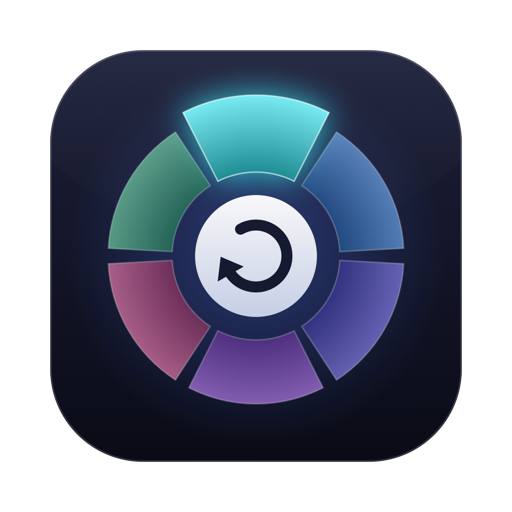
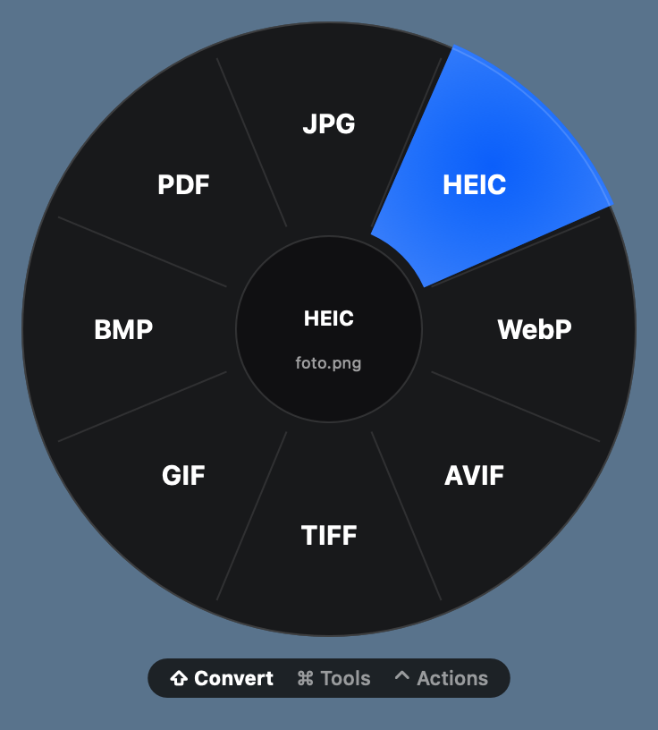
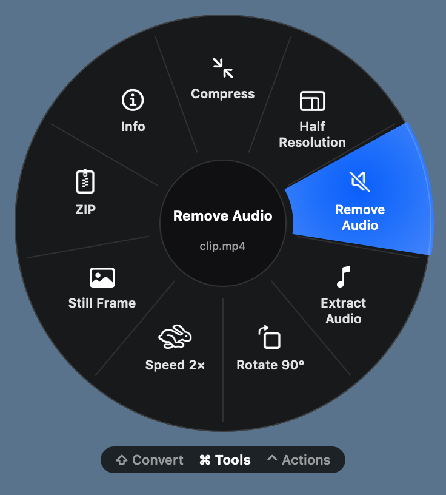

<p align="center">
  
</p>

<h1 align="center">Rondo</h1>
<p align="center"><b>Trascina. Tocca. Fatto.</b><br>Il convertitore di file offline per macOS, sempre sulla punta del cursore.</p>

<p align="center"><a href="README.md">🇬🇧 English</a></p>

---

Inizia a trascinare un file, tocca un tasto modificatore e attorno al cursore compare una ruota di opzioni. Rilascia su uno spicchio: fatto.
Tutto gira **in locale sul tuo Mac**: niente upload, niente account, niente abbonamenti.

<p align="center">
  
  
</p>

## Come funziona

1. **Inizia a trascinare** un file (Finder, Scrivania, qualsiasi app).
2. **Tocca un tasto** mentre trascini (puoi lasciarlo subito):
   - `⇧ Shift` → **Converti**
   - `⌘ Command` → **Strumenti**
   - `⌃ Control` → **Azioni**
3. **Rilascia su uno spicchio.** Il risultato è una nuova copia accanto all'originale. Al centro = annulla.

Tocca un altro tasto durante il trascinamento per cambiare ruota. Da tastiera: seleziona i file nel Finder e premi **⌃⌥R**, poi frecce, Tab e Invio.

## Cosa fa

| File | Converti | Strumenti |
|---|---|---|
| Immagini | JPG, PNG, HEIC, WebP, AVIF, TIFF, GIF, BMP, PDF (anche SVG e RAW) | Comprimi, Rimuovi sfondo, Riduci 50%, Ruota, Specchia, Bianco e nero, Rimuovi metadati, Unisci in PDF |
| Audio | MP3, M4A, WAV, FLAC, AIFF, OGG, Opus, WMA | Comprimi, Normalizza, Mono, Togli silenzi, Velocità 1.5× |
| Video | MP4, MOV, MKV, WebM, AVI, WMV, GIF, MP3, M4A | Comprimi, Metà risoluzione, Togli audio, Estrai audio, Ruota, Velocità 2×, Fotogramma |
| PDF | DOCX, TXT, Markdown, RTF, HTML, ODT, PNG, JPG | Unisci, Dividi pagine, Comprimi, Ruota pagine, Prima pagina |
| Documenti | DOCX, PDF, TXT, Markdown, RTF, HTML, ODT, DOC | Conta parole |
| Tabelle (CSV/TSV) | CSV, TSV, JSON, HTML, Markdown | Conta parole |
| Sottotitoli | SRT, VTT, TXT | |
| Archivi (ZIP, TAR, GZ, RAR, 7Z…) | Estrai, ZIP, TAR.GZ | |
| Qualsiasi file | | ZIP, TAR.GZ, Info (metadati, GPS, durata, pagine…) |

**Azioni** per qualsiasi file o cartella: AirDrop, Float (scaffale sempre in primo piano), Copia, Copia percorso, Sposta in…, Copia in…, Terminale, Mostra nel Finder.

Disponibile in **italiano, inglese, spagnolo, francese, tedesco e portoghese**.

## Installazione

1. Scarica `Rondo-x.y.z.dmg` dalla pagina [Releases](../../releases).
2. Aprilo e trascina **Rondo** in **Applicazioni**.
3. Al primo avvio macOS lo blocca una volta, perché l'app non è ancora notarizzata da Apple:
   vai in **Impostazioni di Sistema → Privacy e sicurezza** e premi **Apri comunque**
   (oppure `xattr -dr com.apple.quarantine /Applications/Rondo.app`).

**Aggiornamenti:** una volta al giorno Rondo chiede a GitHub se esiste una versione più recente (non invia nulla su di te o sui tuoi file). Si disattiva nelle Impostazioni.

**Facoltativo, per tutti i formati audio/video:** `brew install ffmpeg`.

## Compilare

```bash
./build.sh        # → dist/Rondo.app
./make_dmg.sh     # → dist/Rondo-1.0.0.dmg
```

## Licenza

[MIT](LICENSE): libera da usare, modificare e condividere.
