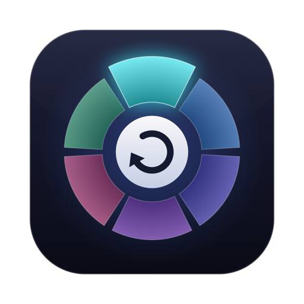
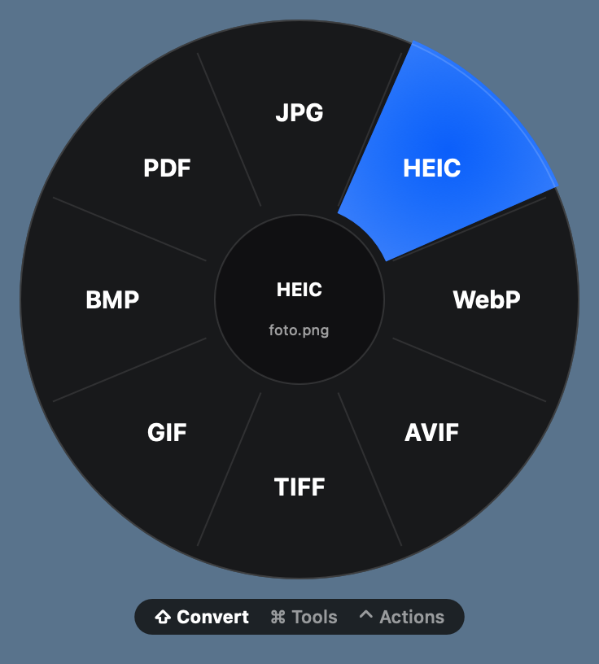
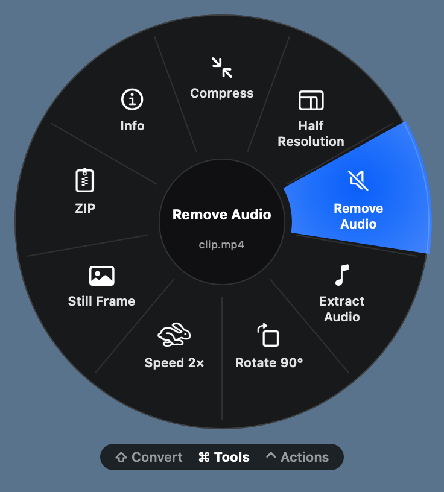

<p align="center">
  
</p>

<h1 align="center">Rondo</h1>
<p align="center"><b>Drag. Tap. Done.</b><br>The offline file converter for macOS that lives at the tip of your cursor.</p>

<p align="center">
  <a href="LICENSE"></a>
  
  
</p>

<p align="center"><a href="README.it.md">🇮🇹 Leggi in italiano</a></p>

---

Start dragging any file, tap a modifier key, and a wheel of options blooms around your cursor. Drop on a slice — done.
Everything runs **locally on your Mac**: no uploads, no accounts, no subscriptions.

<p align="center">
  
  
</p>

## How it works

1. **Start dragging** a file (Finder, Desktop, any app).
2. **Tap a key** while dragging — you can let go of it right away:
   - `⇧ Shift` → **Convert**
   - `⌘ Command` → **Tools**
   - `⌃ Control` → **Actions**
3. **Drop on a slice.** The result is saved as a new copy next to the original. Drop in the center to cancel.

Tap another key mid-drag to switch wheels. Prefer the keyboard? Select files in Finder and press **⌃⌥R**, then use the arrow keys, Tab and Return.

## What it does

| Files | Convert | Tools |
|---|---|---|
| Images | JPG, PNG, HEIC, WebP, AVIF, TIFF, GIF, BMP, PDF (SVG & RAW input) | Compress, Remove background, Shrink 50%, Rotate, Flip, Black & white, Remove metadata, Combine into PDF |
| Audio | MP3, M4A, WAV, FLAC, AIFF, OGG, Opus, WMA | Compress, Normalize, Mono, Trim silence, Speed 1.5× |
| Video | MP4, MOV, MKV, WebM, AVI, WMV, GIF, MP3, M4A | Compress, Half resolution, Remove audio, Extract audio, Rotate, Speed 2×, Still frame |
| PDF | DOCX, TXT, Markdown, RTF, HTML, ODT, PNG, JPG | Merge, Split pages, Compress, Rotate pages, First page |
| Documents | DOCX, PDF, TXT, Markdown, RTF, HTML, ODT, DOC | Word count |
| Tables (CSV/TSV) | CSV, TSV, JSON, HTML, Markdown | Word count |
| Subtitles | SRT, VTT, TXT | |
| Archives (ZIP, TAR, GZ, RAR, 7Z…) | Extract, ZIP, TAR.GZ | |
| Anything | | ZIP, TAR.GZ, Info (metadata, GPS, duration, pages…) |

**Actions** work on any file or folder: AirDrop, Float (an always-on-top shelf you can drag files back out of), Copy, Copy Path, Move to…, Copy to…, Terminal, Show in Finder.

Available in **English, Italiano, Español, Français, Deutsch and Português** (follows your system language, or pick one in Settings).

## Install

1. Download `Rondo-x.y.z.dmg` from [Releases](../../releases).
2. Open it and drag **Rondo** into **Applications**.
3. First launch: Rondo isn't notarized by Apple yet, so macOS will block it once.
   Open **System Settings → Privacy & Security** and click **Open Anyway** (or run `xattr -dr com.apple.quarantine /Applications/Rondo.app`).

Rondo lives in the menu bar. No Accessibility permission is needed; ⌃⌥R asks once for permission to read the Finder selection.

**Optional, for every audio/video format:** `brew install ffmpeg` (and `brew install webp` for WebP output if your macOS can't write it natively). Without ffmpeg Rondo still handles M4A/WAV/AIFF/FLAC and MP4/MOV through macOS's own frameworks.

## Build from source

Requires the Xcode Command Line Tools (Swift 5.9+).

```bash
git clone https://github.com/tocca89/rondo.git
cd rondo
./build.sh        # → dist/Rondo.app
./make_dmg.sh     # → dist/Rondo-1.0.0.dmg
```

Command-line mode, handy for scripts:

```bash
dist/Rondo.app/Contents/MacOS/Rondo --list convert photo.heic
dist/Rondo.app/Contents/MacOS/Rondo --run convert PNG photo.heic
```

Wheel item names follow the app language.

## Project layout

```
Sources/Rondo/
  Wheel.swift         drag detection, radial wheel, animations
  Catalog.swift       which options appear for which files
  ImageOps / MediaOps / DocOps / TextOps / ActionOps   the conversions and actions
  Panels.swift        HUD with progress ring, Float shelf
  Onboarding.swift    interactive first-run practice
  Localization.swift  all translations in one table
Scripts/              icon and DMG background renderers
```

**Adding a language:** add a column to the table in `Localization.swift` and the code to `Lang.all` / `Lang.others`.

## Contributing

Issues and pull requests are welcome — new formats, translations and bug reports especially.
Debug logging: `defaults write app.rondo.Rondo debugLog -bool true`, then see `~/Library/Logs/Rondo.log`.

## License

[MIT](LICENSE) — free to use, modify and share.

## Releasing (maintainers)

CI builds the app and an unstyled DMG on every push. Release DMGs are built on a Mac so the Finder window gets its background and layout:

```bash
./build.sh && ./make_dmg.sh
gh release create v1.0.0 dist/Rondo-1.0.0.dmg --title "Rondo 1.0.0" --notes-file CHANGELOG.md
```
